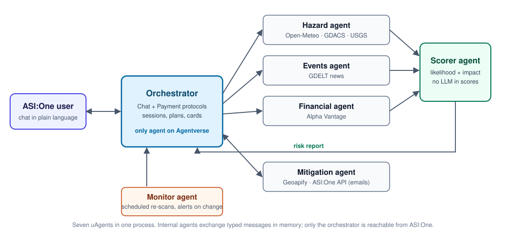

# SupplyPulse

**Supply-chain early warning for small manufacturers, delivered as a conversation in ASI:One.**

SupplyPulse monitors the weather, natural disasters, local news and financial health around every supplier and
port a manufacturer depends on, then ranks the risks by *how exposed that business is*, not merely by what is
happening in the world. It is a multi-agent system built on Fetch.ai's uAgents framework and uses the Chat
Protocol for the conversation and the Agent Payment Protocol for monetisation.

> **Try it:** open the `supplypulse` agent on Agentverse
> (`agent1qfussjr6068em5w3tnwkqujuhn52rcp8gk5tjk4wav6ypz09hwnhzppycde`), choose *Chat with Agent*, and describe your
> supply chain in plain language.

---

## 1. The problem

A garment exporter in Tiruppur depends on five to twenty suppliers across India, China, Vietnam or Bangladesh.
When a cyclone closes a port, a supplier's region floods, or a supplier's parent company runs into trouble, large
enterprises know within hours because they pay for risk-monitoring platforms. A small manufacturer finds out weeks
later, when a shipment misses its date and an export order is penalised or lost.

## 2. The solution

SupplyPulse gives a small manufacturer that early warning at small-business cost, with no dashboard to learn.

**Core idea: rank risk by exposure, not by events.** A typhoon near a single-source supplier matters greatly when
you hold ten days of stock. It matters much less when you have a backup supplier and sixty days of stock.
SupplyPulse computes this from the user's own data, which a generic news feed cannot do.

| What the user does | What SupplyPulse does |
|---|---|
| Describes their supply chain in a sentence | Extracts suppliers, locations, components and the shipping port |
| Confirms or corrects the guesses | Locates every supplier and port on the map |
| Asks for a risk check | Checks hazards, news and finances for every supplier in parallel and scores each one |
| Asks what to do about a risk | Finds alternative suppliers and drafts the email to send |
| Subscribes | Re-checks on a schedule and alerts only when a supplier's risk level changes |

## 3. Using it

1. **Describe your supply chain.** For example: *"I make cotton garments in Tiruppur. Fabric comes from a mill in
   Erode, zippers from Shenzhen, buttons from Ningbo, dyes from Ankleshwar. I ship to Europe through Chennai port."*
2. **Review the map** SupplyPulse shows back. Correct its guesses about importance, stock and replacement time.
3. Reply **`confirm`** to run the first risk check.
4. Read the **risk check**: an overall level, one row per supplier with a colour and a one-sentence reason, and an
   honest "How complete is this check?" section.
5. **Act**: ask for evidence (`why 2`), alternatives (`alternatives 1`), or a drafted email (`email 1`).

The dashboard ends with the exact commands worth running next. Everything is plain language: no raw errors,
no jargon.

### Command reference

Commands are plain messages typed in the chat. `N` is a supplier number shown in the risk check.

**Set up your supply chain**

| Command | Example | What it does |
|---|---|---|
| A sentence about your suppliers | `Zippers from Shenzhen, I ship through Chennai port` | Starts onboarding, or replaces a map you have not confirmed |
| `ITEM: key=value ...` | `zippers: stock=10 critical=high backup=yes lead=30` | Corrects a supplier before you confirm |
| `confirm` | `confirm` | Locks in the map and runs the first risk check |
| `restart` | `restart` | Starts onboarding again |

The correction keys are `stock` (days of stock), `critical` (low, medium or high), `backup` (yes or no), `lead`
(days to replace the supplier) and `company` (a listed company name, which adds a financial-health check):

```
zippers: company=YKK Corp stock=12
```

**Check and understand risk**

| Command | Example | What it does |
|---|---|---|
| `scan` | `scan` | Runs a fresh risk check |
| `results` | `results` | Shows the latest risk check or draft again |
| `why N` | `why 2` | Shows the evidence and score breakdown for supplier N |

**Act on a risk**

| Command | Example | What it does |
|---|---|---|
| `alternatives N` | `alternatives 1` | Lists candidate alternative suppliers for supplier N |
| `email N` | `email 1` | Drafts a delay inquiry to your current supplier N |
| `inquire M` | `inquire 2` | Drafts an inquiry to alternative M from the last `alternatives` list |

**Plans and account**

| Command | Example | What it does |
|---|---|---|
| `plans` | `plans` | Shows the Free, Pro and Deep report plans |
| `upgrade` | `upgrade` | Pays for Pro in chat |
| `buy deep N` | `buy deep 1` | Pays for a deep report on supplier N |
| `delete my data` | `delete my data` | Erases your suppliers and session |
| `help` | `help` | Lists the commands |

**Monitoring and demonstration**

| Command | Example | What it does |
|---|---|---|
| `alerts` | `alerts` | Shows monitoring alerts |
| `dismiss` | `dismiss` | Clears the alerts |
| `replay list` | `replay list` | Lists the recorded scenarios |
| `replay NAME` | `replay chennai-cyclone` | Runs checks on a recorded real event, always labelled as a replay |
| `replay alert` | `replay alert` | Shows what a monitoring alert looks like for the active replay |
| `replay off` | `replay off` | Returns to live data |

## 4. How it works



Seven uAgents run in one process. Only the **orchestrator** is registered on Agentverse and reachable from ASI:One;
the six internal agents exchange typed messages in memory.

- A scan gets a unique ID. The orchestrator asks the hazard, events and financial agents for every supplier in
  parallel, each tagged with that ID. The **scorer** collects results until all arrive or 20 seconds pass, so a
  slow source never blocks the answer. Repeated messages with the same ID are ignored.
- **Chat Protocol** carries the conversation. **Agent Payment Protocol** handles subscriptions: the orchestrator
  requests payment, the user's wallet commits it, and the transfer is verified on the Fetch.ai ledger before any
  access is granted.
- The LLM (ASI:One API) is used only for understanding the user's description, drafting emails and suggesting where
  to look. **It never produces a score.**

### The risk model

Each supplier's risk is `Likelihood × Impact`, computed deterministically, so every score traces to its evidence.

- **Likelihood** blends four signals (each 0 to 1): *hazard* (weather now and forecast, cyclone, flood and
  earthquake alerts near the supplier and its port, weight 0.45), *events* (strikes, closures and fires in the
  news, 0.25), *financial* (news sentiment and fundamentals of a listed supplier, 0.10) and *concentration*
  (single-source items, suppliers sharing a city, 0.20).
- **Impact** comes from the user's own inputs: how important the item is, whether a backup exists, and
  **exposure** = replacement time ÷ days of stock. When replacing supply takes longer than the stock lasts,
  impact is high.
- Scores map to 🔴 high (≥ 0.50), 🟠 medium (≥ 0.20) and 🟢 low. **A missing signal is never read as low risk:**
  unavailable signals are excluded, named in the report, and a supplier with no external data shows ⚪ unknown.

### Reliability

| Mechanism | What it does |
|---|---|
| Adapter per data source | Timeout, then the last cached result marked with its age |
| Circuit breaker | After 3 failures a source is skipped for 5 minutes instead of waited on |
| Honest partial results | Every report states what could and could not be checked, in plain words |
| Background refresh | Slow sources (GDACS) refresh in the background; rate-limited ones (GDELT) are throttled and cached |
| Idempotent scans | A repeated message with the same scan ID is ignored |
| Payment safety | Access is granted only after on-chain verification; a deep-report credit survives a failed delivery |
| Scenario replay | A recorded real event (GDACS record of Cyclone Michaung, December 2023) runs through the same pipeline, so the system can be demonstrated on a calm day |

### Data sources

| Signal | Source | Key |
|---|---|---|
| Place to coordinates | Built-in city list, then Open-Meteo geocoding | none |
| Weather now and 5-day forecast | Open-Meteo | none |
| Cyclones, floods | GDACS | none |
| Earthquakes | USGS | none |
| Local news | GDELT | none |
| Ticker, fundamentals, sentiment | Alpha Vantage | `ALPHAVANTAGE_API_KEY` (optional) |
| Alternative suppliers | Geoapify Places | `GEOAPIFY_API_KEY` |
| Understanding, emails, suggestions | ASI:One API | `ASI1_API_KEY` |

## 5. Plans and payment

| Plan | Includes | Price (testnet) |
|---|---|---|
| Free | One risk check, up to 5 suppliers, one alternatives/email preview | free |
| Pro | Unlimited checks and suppliers, scheduled monitoring and alerts, alternatives and emails, 30 days | 0.5 FET |
| Deep report | Alternatives and drafted emails for one supplier | 0.2 FET |

Prices are configurable (`PRO_PRICE_FET`, `DEEP_PRICE_FET`). Distribution beyond direct sign-up: industry
associations and export councils could offer it to members, and freight forwarders could white-label it.

## 6. Setup

```powershell
python -m venv .venv
.\.venv\Scripts\pip install -r requirements.txt
copy .env.example .env        # then fill in the keys
```

| Variable | Purpose |
|---|---|
| `ASI1_API_KEY` | Understanding free-text descriptions, emails, suggestions (falls back to a simple parser and templates) |
| `GEOAPIFY_API_KEY` | Alternative-supplier search |
| `ALPHAVANTAGE_API_KEY` | Optional financial check |
| `AGENT_SEED_PREFIX` | Fixes the agents' addresses. Use a long random value and never change it |
| `USE_MAILBOX` | `1` for ASI:One (default), `0` for local-only testing |
| `MONITOR_INTERVAL_S` | Monitoring interval in seconds (86400 = daily) |
| `ALLOW_UNVERIFIED_PAYMENTS` | `1` skips only the on-chain check, for testing. Keep `0` |

**Connect to ASI:One (one time).** Run `python -m agents.orchestrator`, open the Inspector link it prints, sign in to
Agentverse and connect a **Mailbox**, then stop it.

**Run.** `python -m agents.run_all` starts every agent in one process. Then chat with the agent from its Agentverse
profile.

**Run without Agentverse.** `python -m tests.chat_client` drives the full system from the terminal.

## 7. Testing

```powershell
.\.venv\Scripts\python -m pytest        # 59 hermetic tests: no network, no keys
```

The suite covers the scoring model (exposure beats events, missing data is never green), the adapters with
failure injection, onboarding, the dialog, plan gating, monitoring and change detection, the payment request
format and on-chain verification rules, and the plain-language rendering of every card.
`python -m scripts.payment_roundtrip` simulates a buyer wallet through the full payment flow, and
`python -m scripts.check_balance <wallet>` checks a testnet balance.

## 8. Project layout

```
agents/       orchestrator, hazard, events, financial, scorer, mitigation, monitor, billing, dialog, run_all
adapters/     resilient data access: timeout, circuit breaker, cache, and the public-API sources
scoring/      deterministic risk model, hazard / event / financial scoring, plain-language explanations
mitigation/   alternative-supplier search, sourcing guidance, email drafting
onboarding/   free text to structured suppliers
render/       the text cards shown in chat
replay/       recorded scenarios
models/       shared message models
store.py      minimal JSON persistence
tests/        automated tests and a local chat client
```

## 9. Limitations

- ASI:One's chat protocol has no buttons, so interactive "cards" are formatted text with commands such as `why 2`.
- Replies the agent sends on its own after the first acknowledgement may not appear in ASI:One; `results` shows the
  latest output on demand, and `alerts` lists monitoring alerts.
- Most small suppliers are not listed companies, so the financial signal is often absent. Hazard and event
  signals carry most of the weight, and the report says so.
- Map data is sparse for small suppliers and poor inside China. Alternatives are businesses whose *name* matches
  the component and are always presented as unverified, with sourcing leads to check by hand.
- Local news depends on GDELT, which rate-limits heavily. When it is unavailable the report says so rather than
  implying there is no news.
- Open-Meteo's free tier is non-commercial; a commercial deployment needs its paid plan.
- Payments use the Fetch.ai **testnet**. The request format and on-chain verification are covered by tests and a
  simulated buyer; a payment from a funded ASI:One wallet is still to be verified end to end.
- Stored supplier data is plain JSON (`data/state.json`), kept to the minimum and removable with
  `delete my data`; encryption at rest is future work.
